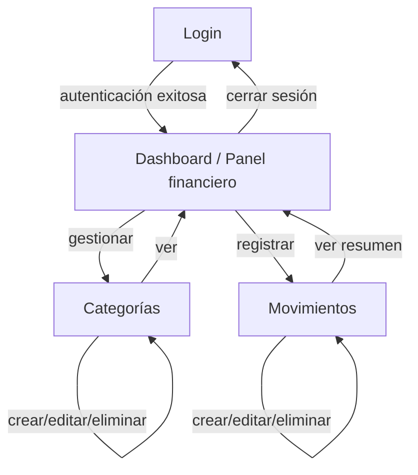

# 📘 Expense Manager — Flujo de la aplicación y diseño de interfaz

> **Autor:** Arquitectura de software (capa de presentación)  
> **Proyecto:** Expense Manager (Django + Python)  
> **Estado:** Mejora exclusivamente de interfaz (UI/UX). **No se modificó la lógica de negocio** (modelos, vistas, formularios ni URLs de la aplicación).

---

## 1. Alcance de los cambios

Esta intervención se限ó estrictamente a la **capa de presentación**:

| ¿Qué se tocó? | ¿Se modificó la lógica? |
|---------------|-------------------------|
| Plantillas HTML (`templates/`) | ✅ Sí (estructura y estilo) |
| CSS propio (`static/css/style.css`) | ✅ Sí (nuevo archivo) |
| `config/settings.py` | ✅ Solo `STATICFILES_DIRS` (configuración estática) |
| `expenses/models.py` | ❌ No |
| `expenses/views.py` | ❌ No |
| `expenses/forms.py` | ❌ No |
| `expenses/urls.py` | ❌ No |
| `config/urls.py` | ❌ No |

**Resultado:** la aplicación funciona exactamente igual a nivel de reglas de negocio, pero con una interfaz fresca, coherente, responsiva y con mensajes de error y éxito visualmente cuidados.

---

## 2. Flujo de la aplicación

El usuario autenticado navega por este flujo principal:



### Paso a paso por pantalla

| Pantalla | Qué hace el usuario | Destino tras acción |
|----------|---------------------|---------------------|
| **Login** (`/accounts/login/`) | Ingresa usuario y contraseña | Redirige al **Dashboard** |
| **Dashboard** (`/`) | Ve ingresos, gastos y balance. Accede a Movimientos o Categorías | `transaction_list` o `category_list` |
| **Movimientos** (`/transactions/`) | Lista, crea, edita o elimina movimientos | `transaction_list` tras cada acción |
| **Nuevo movimiento** (`/transactions/create/`) | Completa descripción, monto, fecha y categoría | `transaction_list` con mensaje de éxito |
| **Categorías** (`/categories/`) | Lista, crea, edita o elimina categorías | `category_list` tras cada acción |
| **Cerrar sesión** | Cierra la sesión de usuario | `login` |

> **Nota de negocio sin cambios:** una categoría con transacciones asociadas no se puede eliminar (`ProtectedError`). Ese comportamiento se preserva intacto y solo se notifica al usuario mediante un mensaje de error con estilo.

---

## 3. Sistema de diseño (UI)

### Paleta de colores

| Rol | Color | Uso |
|-----|-------|-----|
| Verde principal | `#10b981` | Botones primarios, acentos, activos |
| Verde oscuro | `#047857` | Títulos, textos principales de marca |
| Verde claro / fondo | `#f0fdf4`, `#ecfdf5` | Fondos, estados activos, gradientes |
| Blanco | `#ffffff` | Tarjetas, superficies elevadas |
| Gris neutro | `#f3f4f6` … `#111827` | Texto secundario, bordes, fondos suaves |
| Éxito | `#10b981` (fondo `#d1fae5`) | Mensajes de operación exitosa |
| Error | `#dc2626` (fondo `#fee2e2`) | Mensajes de error y validación |

### Gradientes y efectos

- **Fondo del cuerpo:** gradiente diagonal verde muy claro → blanco → verde muy claro (`linear-gradient(135deg, #ecfdf5, #ffffff, #f0fdf4)`), que da sensación de frescura y profundidad sin recargar la vista.
- **Botón primario:** gradiente verde `#059669` → `#4ade80` con sombra suave y efecto de elevación al pasar el mouse.
- **Tarjetas (cards):** blanco con borde sutil verde y sombra elevada; al hacer hover se elevan ligeramente y muestran un brillo gradiente interno.
- **Navbar:** vidrio esmerilado (`backdrop-filter: blur`) con borde inferior verde tenue.

### Tipografía

- Fuente: **Inter** (cargada desde Google Fonts) con pesos 400, 600, 800 y 900 para jerarquía clara.
- Títulos de marca en verde oscuro, peso 900.

---

## 4. Componentes de interfaz

Todos los componentes viven en `static/css/style.css` y se consumen desde `templates/base.html` (layout maestro) y las plantillas hijas.

### 4.1 Layout maestro (`base.html`)
- Navbar fija superior con logo, navegación (Inicio, Movimientos, Categorías) y botón "Cerrar sesión".
- Área de mensajes globales (alertas de éxito/error) justo debajo del navbar.
- Contenedor de contenido centrado con ancho máximo 1280 px.
- Pie de página fijo inferior con copyright.

### 4.2 Tarjetas de métricas (Dashboard)
Tres tarjetas con iconos y gradiente interno:
- **Ingresos totales** (verde)
- **Gastos totales** (rojo suave)
- **Balance disponible** (verde oscuro)

### 4.3 Tablas
- Encabezado verde claro, filas zebra, hover resaltado en verde muy claro.
- Celdas de tipo con badge colorado: ingreso (verde) / gasto (rojo).
- Columna de acciones con botones Editar (outline verde) y Eliminar (rojo).

### 4.4 Formularios
- Tarjeta blanca centrada, máx. 620 px.
- Etiquetas en negrita, inputs con fondo gris muy claro, borde verde al enfocar y anillo de enfoque accesible.
- Selects con flecha personalizada.
- Errores de campo mostrados debajo de cada input con ícono de advertencia.

### 4.5 Confirmación de eliminación
Tarjeta centrada con título, descripción, botón Cancelar (outline) y botón Confirmar eliminación (rojo).

### 4.6 Estado vacío
Cuando no hay datos (sin movimientos o sin categorías), se muestra una ilustración SVG, título, descripción y botón de acción primaria para crear el primer registro.

### 4.7 Login
Tarjeta centrada en la pantalla con marca, campos de usuario/contraseña, botón "Ingresar" de ancho completo y enlace "¿Olvidaste tu contraseña?".

---

## 5. Mensajes de error y éxito

La aplicación usa el sistema de mensajes de Django (`django.contrib.messages`), renderizado en `base.html` como **alertas tipo toast**:

- **Éxito (`messages.success`):** fondo verde muy claro (`#d1fae5`), borde izquierdo verde intenso, ícono de check, texto verde oscuro.
  - Ejemplos: "Categoría creada.", "Movimiento registrado.", "Categoría eliminada."
- **Error (`messages.error`):** fondo rojo muy claro (`#fee2e2`), borde izquierdo rojo, ícono de alerta, texto rojo oscuro.
  - Ejemplos: "No puedes eliminar una categoría con transacciones.", errores de validación de formulario.

Ambas alertas tienen animación de entrada (`slideIn`) y cierre visual limpio. Los errores de formulario también se muestran inline bajo cada campo con el estilo `.errorlist`.

---

## 6. Archivos estáticos y configuración

Se agregó a `config/settings.py`:

```python
STATICFILES_DIRS = [
    BASE_DIR / 'static',
]
```

Esto permite que Django sirva `static/css/style.css` tanto en desarrollo (`runserver`) como en producción mediante WhiteNoise (ya incluido en `MIDDLEWARE`) y `collectstatic`.

Estructura de archivos estáticos:

```
static/
└── css/
    └── style.css
```

---

## 7. Cómo ejecutar y verificar

```bash
# 1. Entorno virtual
python -m venv .venv
.venv\Scripts\activate        # Windows
# source .venv/bin/activate   # Linux/macOS

# 2. Dependencias
pip install -r requirements.txt

# 3. Migraciones
python manage.py migrate

# 4. Superusuario (opcional, para admin)
python manage.py createsuperuser

# 5. Servidor de desarrollo
python manage.py runserver

# 6. Abrir
http://127.0.0.1:8000
```

Validaciones recomendadas:

```bash
python manage.py check          # configuración Django
python manage.py test           # pruebas automatizadas
python manage.py collectstatic  # archivos estáticos para producción
```

---

## 8. Decisiones de arquitecto (resumen)

1. **Separación estricta:** lógica de negocio intacta; solo se mejoró la presentación. Esto evita regresiones y mantiene los tests existentes válidos.
2. **CSS propio sin frameworks pesados:** menor tamaño de bundle, control total del diseño verde/blanco y dependencias mínimas.
3. **SVG inline:** iconos e ilustraciones sin peticiones HTTP externas, lo que hace la interfaz más rápida y funciona sin conexión.
4. **Mensajes unificados:** éxito y error usan el mismo sistema de alertas, con colores semánticos y animaciones suaves para retroalimentación clara al usuario.
5. **Responsive:** navegación, tarjetas, tablas y formularios se adaptan a móviles (`@media (max-width: 640px)`).
6. **Accesibilidad básica:** contraste verde oscuro sobre blanco, enfoque visible en inputs, etiquetas asociadas a campos y texto alternativo semántico en títulos.

---

## 9. Próximas mejoras sugeridas (fuera de este alcance)

- Paginación en listados de movimientos y categorías.
- Filtros por fecha y tipo de categoría.
- Gráficos de ingresos vs. gastos (Chart.js).
- Exportación a CSV/PDF.
- Modo oscuro opcional.
- Pruebas de interfaz (Playwright / Selenium).
